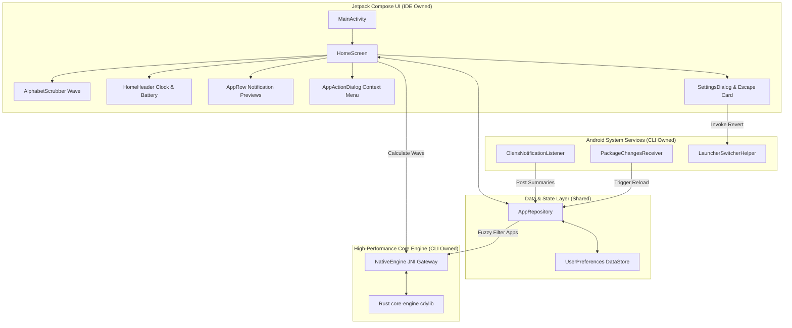

# 🏗️ Olens Launcher - Architecture & Contract Specification

**Repository**: `https://github.com/ayushpalg46/OlensLauncher.git`  
**Stack**: Pure Kotlin 2.0.20 + Pure Rust 1.98.1 (Zero other languages)  
**Target Platform**: Android 8.0+ (API 26 to 34), Modern Edge-to-Edge  

---

## 1. High-Level System Architecture

---

## 2. Native JNI Contracts (Rust <-> Kotlin)

### Shared Library: `libolens_core.so`
Built via `cargo-ndk` targeting:
- `arm64-v8a` (`aarch64-linux-android`)
- `armeabi-v7a` (`armv7-linux-androideabi`)
- `x86_64` (`x86_64-linux-android`)

### Function Signatures & Bytecode Mappings:

| Kotlin Method (`NativeEngine.kt`) | JNI Export (`core-engine/src/lib.rs`) | Purpose | Return Value |
| :--- | :--- | :--- | :--- |
| `nativeInit(): Boolean` | `Java_com_olens_launcher_core_NativeEngine_nativeInit` | Engine handshake & sanity test | `jboolean` (true) |
| `nativeQuickScore(query, target): Int` | `Java_com_olens_launcher_core_NativeEngine_nativeQuickScore` | Single pair fuzzy heuristic match | `jint` score (0-10000) |
| `nativeCalculateWaveOffsets(selectedIndex, totalCount, radius, maxOffsetPx): FloatArray` | `Java_com_olens_launcher_core_NativeEngine_nativeCalculateWaveOffsets` | Cosine bell-curve wave expansion for alphabet scrubber | `jfloatArray` offsets |
| `nativeFuzzySearch(query, labels, packages): IntArray` | `Java_com_olens_launcher_core_NativeEngine_nativeFuzzySearch` | High-speed batch ranking of entire app directory | `jintArray` ordered indices |

---

## 3. DataStore & Persistence Schema (`UserPreferences.kt`)

| Key Name | Storage Type | Default | Description |
| :--- | :--- | :--- | :--- |
| `KEY_FAVORITES` | `Set<String>` | `emptySet()` | Pinned app package names displayed at top of launcher |
| `KEY_HIDDEN` | `Set<String>` | `emptySet()` | App package names hidden from main drawer |
| `KEY_RIGHT_HANDED` | `Boolean` | `true` | Scrubber placement: `true` = Right edge, `false` = Left edge |
| `KEY_HAPTICS` | `Boolean` | `true` | Tactile feedback on alphabet item transitions (`CLOCK_TICK`) |
| `KEY_PURE_AMOLED` | `Boolean` | `true` | Pure `#000000` background mode |
| `custom_label_<pkg>` | `String?` | `null` | User-defined custom display name overriding system label |

---

## 4. Emergency Escape Subsystem (`LauncherSwitcherHelper.kt`)

To guarantee the user never gets locked out:
1. `getInstalledLaunchers()` filters all activities with `CATEGORY_HOME` excluding `com.olens.launcher`.
2. `clearDefaultLauncher()` calls `packageManager.clearPackagePreferredActivities(context.packageName)`.
3. `revertToOldLauncher()` attempts direct launch of the detected stock OEM launcher (e.g. Samsung One UI `com.sec.android.app.launcher`, Pixel Launcher `com.google.android.apps.nexuslauncher`, MIUI Launcher, etc.).
4. Fallback triggers `ACTION_MANAGE_DEFAULT_APPS_SETTINGS` or `ACTION_HOME_SETTINGS` to open Android's Default Home App chooser.
