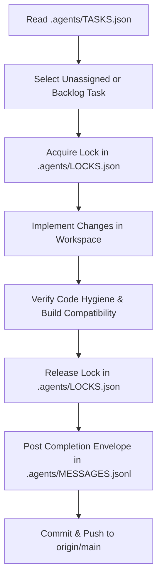

# 🛰️ Antigravity Dual-Agent Protocol (ADAP)

**Target System**: Olens Launcher (100% Kotlin + Rust Android Launcher)  
**Agents**: `Antigravity CLI` ⚡ and `Antigravity IDE` 🎨  
**Coordination Directory**: `.agents/`

---

## 1. Core Operating Principles

1. **Shared Workspace Harmony**:
   - Both agents operate directly on the same local workspace (`D:\Olens Lanucher`) and remote repository (`origin/main`).
   - Prior to modifying any file, the agent must check `.agents/LOCKS.json`. If locked by the other agent, proceed to a different task or wait.
   - Always run `git status` / inspect recent commits before modifying shared components.

2. **Strict Language Constraints**:
   - Only **Kotlin** (Android UI, Jetpack Compose, System Services) and **Rust** (Native Core via JNI).
   - Zero Java files or external scripting languages in production builds.

3. **Compiler Hygiene & Zero-Slop Rules**:
   - Avoid Kotlin 2.1 preview experimental syntax: use standard `catch (e: Exception)` instead of `catch (_: Exception)`.
   - On primitive arrays (`IntArray`, `FloatArray`), avoid object collection extensions like `mapNotNull`; prefer explicit loops or convert to List (`.toList().mapNotNull`).
   - Keep JNI signatures strictly synchronized between `core-engine/src/lib.rs` and `NativeEngine.kt`.

---

## 2. Coordination State Files

| File | Purpose | Update Cadence |
| :--- | :--- | :--- |
| `.agents/STATUS.json` | Project state, health, active sprint, and module registry | Updated upon major milestone completion |
| `.agents/LOCKS.json` | Real-time file lock registry to prevent race conditions | Updated immediately before & after editing shared files |
| `.agents/TASKS.json` | Sprint task queue, assignment (`CLI` / `IDE`), status, and approval | Updated when claiming, completing, or verifying tasks |
| `.agents/MESSAGES.jsonl` | Append-only event bus for agent-to-agent communication | Append a JSON line on handoffs, review requests, or bug alerts |
| `COORDINATION.md` | Human-readable architecture ledger and changelog | Updated on major collaborative releases |

---

## 3. Work Distribution Matrix

| Subsystem | Primary Owner | Secondary / Reviewer |
| :--- | :--- | :--- |
| **Rust Native Engine** (`core-engine/`) | `Antigravity CLI` | `Antigravity IDE` |
| **CI/CD Pipeline** (`.github/workflows/`) | `Antigravity CLI` | `Antigravity IDE` |
| **Compose UI Polish & Theming** (`ui/theme/`, `HomeScreen.kt`) | `Antigravity IDE` | `Antigravity CLI` |
| **Ergonomic Wave Physics & Touch Tracking** (`AlphabetScrubber.kt`) | `Antigravity CLI` | `Antigravity IDE` |
| **Settings & Preferences** (`UserPreferences.kt`, `SettingsDialog.kt`) | `Antigravity IDE` | `Antigravity CLI` |
| **System Services & Observers** (`OlensNotificationListener.kt`) | `Antigravity CLI` | `Antigravity IDE` |

---

## 4. How an Agent Claims & Completes Work

1. **Claim Task**: Update task status in `.agents/TASKS.json` from `BACKLOG` to `IN_PROGRESS` with your agent ID (`CLI` or `IDE`).
2. **Acquire Lock**: Set `"locked_by": "<AGENT>"` and `"acquired_at": "<ISO-TIMESTAMP>"` in `.agents/LOCKS.json`.
3. **Implement**: Make atomic, clean edits adhering to language standards.
4. **Self-Audit**: Verify syntax, absence of experimental catch patterns, and null safety.
5. **Release Lock & Message**: Set `"locked_by": null` in `LOCKS.json`, update task status to `COMPLETED` (or `READY_FOR_REVIEW`), and append an event envelope to `.agents/MESSAGES.jsonl`.
6. **Push**: Commit with a clean message and push to `origin/main`.
